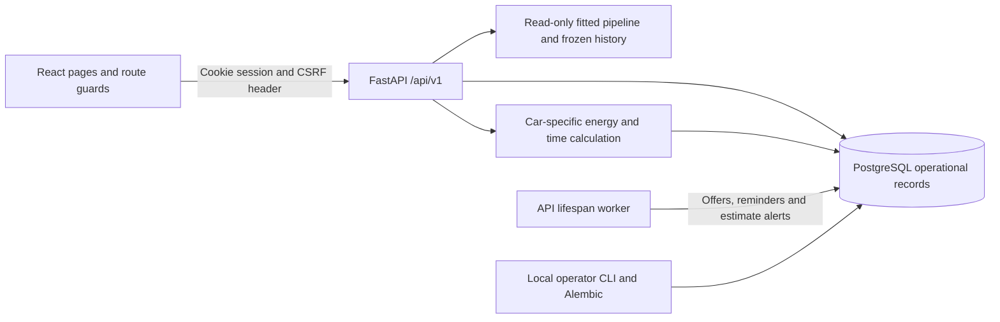

# Elqovanta EV architecture

The Charging Assistant adds `services/assistant.py` for owner-consented target-relative return reminders and bounded read-only charger comparisons. The existing API lifespan worker delivers due optional reminders under charger/session locks. Per-port power is nullable manager-reported operational data, applied by the separate calculator; it never changes the frozen ML feature builder. Researcher-only assistant previews call the original historical scorer plus hypothetical calculator inputs, creating no live schedules or sessions. See `CHARGING_ASSISTANT.md`.

One React/TypeScript/Vite website talks to one FastAPI application and PostgreSQL. Existing working account, charger, queue and research modules were extended rather than replaced.

The worker is inside the API process. There is no Redis, WebSocket server, external scheduler or extra service. PostgreSQL is the durable schedule; a restart catches due reminders on the next worker cycle.

`services/charging_estimates.py` supplies the separate constant-average-power calculator, immutable per-session revisions, ownership/version checks and anonymous station summaries. It uses owner-entered usable capacity, AC/DC limits and current/target readings, not the frozen historical pipeline. A single active revision per session and charger/session locks prevent stale edits or obsolete deliveries. The existing worker persists near-target/target notifications for the owner and current waiting/offered participants. Finished/unplugged/legacy paused sessions stop estimate alerts. Actual reported finish and unplug remain separate from estimated completion. See `CHARGING_ESTIMATES.md` for assumptions and free-host limits.

## Boundaries

- `frontend/src/app`: providers, role-aware routes, sidebar/top bar and mobile drawer.
- `frontend/src/features`: account, charger, queue, session, messaging, notifications, manager and research pages. `coordination` contains next actions, departure/reminder controls, help reports and alternatives. Charger guidance supplies compact automatic advisories and warning confirmations.
- `backend/app/api/v1`: request validation, response DTOs and authorization dependencies.
- `backend/app/services`: accounts, parent-row locking, FIFO transitions, duration calculations, private communication and persistent coordination.
- `backend/app/ml`: validate/load the trusted artifact, construct historical features and execute the saved pipeline. No operational records are used as historical inputs.
- `backend/alembic`: reproducible schema changes. `backend/artifacts` contains ignored trusted local copies and is never served as frontend content.

## Authentication and roles

Passwords are Argon2id hashes. Login cookies contain random opaque tokens; PostgreSQL stores their SHA-256 hashes, expiry and revocation state. Cookies are HttpOnly and SameSite=Lax. Cookie-authenticated mutations require a double-submit CSRF cookie/header pair. Production HTTPS uses secure cookies. Trusted CORS origins are explicit; there is no credentialed wildcard.

Drivers own their sessions, reminders, departure reports, saved records and notifications. Conversations and help reports are private to the reporter/driver and assigned station managers. Managers can operate only assigned chargers. A separate `researcher` role is required for all research/model/outlook and demo-configuration endpoints. Researcher access cannot read private conversations or change station operations. Public signup and profile updates cannot set privileged roles. The CLI provisions those roles locally.

Frontend guards explain denied navigation; the API independently rejects unauthorized requests. Logging out clears query data before another account signs in. Examiner shells do not fetch private conversation lists.

## Transactions and jobs

Normal consequential driver mutations lock the driver row, then the charger, then the relevant queue/session and dependent records. An atomic queue switch locks the acting driver and both charger rows in sorted UUID order, validates the expected existing participation and explicit confirmation, and performs leave/join/reconciliation without intermediate commits. Failed requests roll the complete switch back.

Capacity counts both active sessions and unexpired offers. Unplug updates the session, closes intervals, cancels pending reminders, ends its departure report and reconciles the next offer in one request transaction. Expected departure alone never frees capacity. Unique constraints and idempotency keys prevent duplicate participation, sessions, events, messages and notifications.

The lifespan worker runs synchronous work through a thread, creating/closing its own database sessions. Reminder workers acquire charger/session locks before a reminder claim, matching session cancellation/snooze order. A due reminder's notification and delivered state commit together under a deterministic event key. `SKIP LOCKED` is used only for independent worker claims, not FIFO ordering. Read receipts use a PostgreSQL upsert and keep the greatest timestamp, so repeated effects/tabs cannot race the first insert or move progress backwards.

## Reported time and stale state

Operational instants are timezone-aware UTC. Charger responses expose a timezone: America/Los_Angeles for imported Palo Alto chargers and a manager-configured timezone for manual records, defaulting to UTC. The browser labels device-time inputs and displays reports in charger time. Public departure DTOs omit driver identity and session identifiers and filter expired, retracted and ended records.

Short polling runs while its page/tab is active and is cleaned up on unmount. The UI distinguishes the timestamp/source of an App-reported status from the time of its last successful HTTP refresh. Failed refreshes retain known information, show a stale message and disable consequential actions. Local duration displays interpolate from received server totals without inventing battery telemetry or waiting estimates.

## Frozen research and automatic driver advisory

The supplied bundle is loaded once per process after exact environment/schema checks. Synchronous inference endpoints use FastAPI's worker-thread execution and a bounded inference semaphore. `prediction.py` derives the exact seven fields from the bundle's completion-based 30-day history and runs its fitted pipeline. Date bounds, missing-history `np.nan`, strict outcome/cutoff rules and stored evaluation remain unchanged.

The independent research Model lab remains 2020-only. The later user-directed driver adapter in `driver_advisory.py` applies the same original pipeline to actual server arrival inputs or explicitly planned arrivals, without examiner selection or a demonstration-account requirement. The read-only guidance GET accepts an optional station-local `planned_arrival`, resolves DST without guessing, and bounds it to the next seven days. It converts the instant to the original model zone for features and separately returns station-local context. Plans create no database records. Starting/accepting always requests current guidance, while existing session guidance uses its real timestamp. Present/future output is visibly experimental/outside the historical evaluation. It uses the unchanged frozen-history window, normally zero count plus missing rate for current dates; operational records are never substituted.

Driver advisories cache by artifact/station/port/date/hour and expose only a plain warning and contextual explanation. Session guidance is private and anchored to its actual plugged-in timestamp. Nullable `port_type` fields on sessions/queue entries retain the chosen observed port through handover. The client offers Continue anyway/Go back for a warning before start or offer acceptance; the existing transactional participation checks still govern those actions. Inference failure does not disable coordination. Longer interface explanations are collapsed under Details. See `DRIVER_ADVISORY.md` for the policy and limits.

## Existing-project design adjustment

The recently approved Elqovanta EV logo, white/forest/lime palette and Manrope typography were retained instead of undoing the accepted redesign for the brief's suggested blue colors. Operational semantics, amber warnings and red errors remain distinct. No external publication or new dependencies were required.

Implementation references: [PostgreSQL locking](https://www.postgresql.org/docs/current/explicit-locking.html), [PostgreSQL conflict handling](https://www.postgresql.org/docs/current/sql-insert.html#SQL-ON-CONFLICT), [FastAPI lifespan](https://fastapi.tiangolo.com/advanced/events/), [FastAPI execution](https://fastapi.tiangolo.com/async/#other-utility-functions), and [scikit-learn persistence](https://scikit-learn.org/stable/model_persistence.html).
